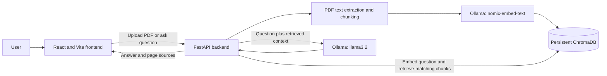

# RAG PDF Analyzer

A local, full-stack application for asking questions about PDF documents. It uses retrieval-augmented generation (RAG): instead of asking a language model to answer from memory, the backend finds relevant passages in the selected PDF and gives those passages to the model as context.

## What it does

- Includes `Project_Overview.pdf` as a default document.
- Accepts PDF uploads through a browser interface.
- Extracts PDF text, splits it into overlapping chunks, and creates an embedding for each chunk.
- Stores the chunks, embeddings, and page references in a persistent ChromaDB collection.
- Finds relevant chunks for a question and asks a local Ollama model to answer using that context.
- Shows the source document and page numbers alongside the answer.

## Architecture



The frontend and backend run as separate local processes. The frontend sends HTTP requests to the backend; the backend calls Ollama for embeddings and answer generation and uses ChromaDB for vector search.

## Request and indexing flow

### Adding a PDF

1. The user selects a PDF in the frontend and uploads it to `POST /upload`.
2. FastAPI saves the file in `documents/`.
3. `read_pdf.py` extracts text one page at a time using `pypdf`.
4. Each page's text is divided into 500-character chunks with a 50-character overlap. The page number is kept with every chunk.
5. Ollama's `nomic-embed-text` model creates an embedding for each chunk.
6. `database.py` stores the chunk text, embedding, filename, and page number in the persistent `documents_v2` ChromaDB collection under `chroma_db/`.

The bundled `documents/Project_Overview.pdf` is indexed automatically when the backend starts, if it has not already been indexed.

### Asking a question

1. The frontend sends the question and selected filename to `POST /ask`.
2. The backend embeds the question with `nomic-embed-text`.
3. ChromaDB returns the three most similar chunks, filtered to the selected filename.
4. If the closest result's distance is greater than `1.0`, the backend returns a “couldn't find that information” response.
5. Otherwise, the backend sends the question and retrieved text to `llama3.2` with instructions to answer using only that context.
6. The backend returns the answer and the retrieved chunks' filename and page metadata. The frontend displays the answer and source pages.

## Technology

| Area | Technology | Role |
| --- | --- | --- |
| Frontend | React 18, Vite 6, JavaScript | PDF upload, document selection, and chat interface |
| API | Python, FastAPI, Uvicorn | Upload and question endpoints |
| PDF processing | pypdf | Extracts text and page numbers |
| Embeddings and language model | Ollama (`nomic-embed-text`, `llama3.2`) | Embeds document chunks/questions and generates answers |
| Vector storage | ChromaDB | Persists and searches document embeddings |

## Project structure

```text
.
├── documents/
│   └── Project_Overview.pdf   # Default sample document
├── frontend/
│   ├── src/
│   │   ├── App.jsx            # Upload, document library, and chat UI
│   │   ├── App.css            # UI styles
│   │   └── main.jsx           # React entry point
│   ├── package.json           # Frontend scripts and dependencies
│   └── package-lock.json
├── chroma_db/                 # Persistent vector data (created at runtime)
├── database.py                # ChromaDB collection and storage helpers
├── generate_answer.py         # Context prompt and Ollama chat call
├── main.py                    # FastAPI app and HTTP endpoints
├── read_pdf.py                # PDF extraction, chunking, and embedding
├── retrieve.py                # Standalone command-line retrieval experiment
└── README.md
```

## Requirements

- Python 3.10 or newer
- Node.js 18 or newer and npm
- [Ollama](https://ollama.com/download)

Pull the models used by the backend:

```shell
ollama pull nomic-embed-text
ollama pull llama3.2
```

Keep Ollama running while using the application. If it does not start automatically, open a separate terminal and run:

```shell
ollama serve
```

## Run locally

Start each service in its own terminal. Run the backend from the repository root so it can find the `documents/` and `chroma_db/` directories.

### 1. Install backend dependencies

On Windows PowerShell:

```powershell
py -m venv venv
.\venv\Scripts\Activate.ps1
python -m pip install --upgrade pip
python -m pip install fastapi uvicorn python-multipart chromadb ollama pypdf
```

On macOS or Linux:

```bash
python3 -m venv venv
source venv/bin/activate
python -m pip install --upgrade pip
python -m pip install fastapi uvicorn python-multipart chromadb ollama pypdf
```

If PowerShell blocks activation, run `Set-ExecutionPolicy -Scope Process -ExecutionPolicy Bypass` in that terminal, then activate the environment again.

### 2. Start the backend

From the repository root, with the virtual environment active:

```shell
uvicorn main:app --reload --host 127.0.0.1 --port 8001
```

- API base URL: <http://localhost:8001>
- Interactive API docs: <http://localhost:8001/docs>
- Health check: open <http://localhost:8001/>; it should return `{"message":"RAG backend is working!"}`.

The first startup indexes the bundled PDF and can take a while because each chunk is embedded separately.

### 3. Start the frontend

Open a second terminal:

```shell
cd frontend
npm install
npm run dev
```

Open the local URL printed by Vite, normally <http://localhost:5173>. Keep the frontend, backend, and Ollama running while using the app. The frontend calls the API at `http://localhost:8001`.

## API

| Method | Path | Input | Purpose |
| --- | --- | --- | --- |
| `GET` | `/` | None | Simple backend health check |
| `POST` | `/upload` | Multipart form field named `file` | Save and index a PDF; returns its filename and chunk count |
| `POST` | `/ask` | JSON: `{"question":"...","filename":"..."}` | Retrieve relevant chunks and return an answer with source metadata |

Example question request:

```json
{
  "question": "What is this document about?",
  "filename": "Project_Overview.pdf"
}
```

## Interview explanation

### Short version

> This project is a local PDF question-answering application built with React, FastAPI, Ollama, and ChromaDB. It extracts and chunks PDF text, embeds the chunks into a persistent vector database, retrieves the most relevant passages for a user's question, and passes those passages to a local language model to generate a grounded answer with page references.

### How to explain the RAG design

> A language model by itself does not know the contents of a user's PDF. At upload time, I extract the text, split it into overlapping chunks, generate vector embeddings, and store those vectors with filename and page metadata. At question time, I embed the question in the same vector space and search only within the selected document. I give the best matching passages to the language model as context, then return its answer with the source pages so the user can verify it.

### Why use these components?

- **RAG instead of sending the entire PDF to the model:** retrieves a small set of relevant passages, grounds the answer in the selected document, and avoids needing to place the whole document in every prompt.
- **Overlapping chunks:** the 50-character overlap helps preserve context when relevant text falls across a chunk boundary.
- **ChromaDB:** stores embeddings persistently and provides similarity search with metadata filters.
- **Ollama:** runs the embedding and chat models locally, avoiding a hosted model API for this prototype.
- **Page metadata:** lets the UI show where retrieved text came from and makes answers easier to check.

## Current scope and limitations

- PDF processing extracts embedded text; scanned/image-only PDFs need OCR, which is not implemented.
- Chunking uses fixed character counts per page, not semantic boundaries or token counts.
- Retrieval uses the top three matches and a fixed distance threshold. Retrieval quality depends on the document, model, and threshold.
- The browser's document list and chat history are held in frontend state; they are not restored after a page reload. The PDF files and ChromaDB index themselves persist locally.
- Chunk IDs are derived from the filename and chunk index. Uploading a PDF again under a filename already indexed can conflict with existing ChromaDB IDs.
- This is a local prototype: it has no authentication, authorization, or production upload/storage hardening.
- The backend currently calls Ollama directly and processes chunk embeddings sequentially, so indexing large PDFs can take time.

## Troubleshooting

- **The frontend cannot reach the API:** confirm the backend is running on port `8001` and Ollama is available.
- **Ollama reports a missing model:** run `ollama list` and pull any missing model with the commands above.
- **The default PDF cannot be found:** run Uvicorn from the repository root.
- **A PDF upload fails to extract text:** confirm the PDF contains selectable text; scanned documents require OCR.
- **Frontend dependencies need a clean install:** run `npm ci` from `frontend/` to install the versions in `package-lock.json`.
